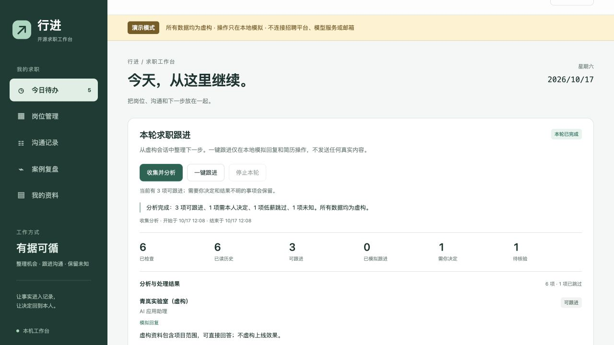

# 行进 · Job Workbench

把求职消息、岗位条件和下一步行动，放在一张工作台上。

这是一个本机运行的求职沟通工作台：点击 **收集并分析** 整理待办，点击 **一键跟进** 处理已授权的动作，遇到需要本人决定的问题就留下来。真实模式通过 Codex App Server 分析资料，通过已登录的官方 BOSS 聊天页操作；没有常驻轮询，也不会在打开网页时自动发送。

**当前版本：0.1.0 Alpha。** 默认提供完全离线的虚构演示。真实连接与发送是需要逐账号验收的实验功能。

## 先看演示



[观看或下载中文讲解视频](https://github.com/zhengshuyuan2023uk/job-workbench/releases/tag/v0.1.0-alpha) · [配置真实工作区](docs/configuration.md) · [验证范围](docs/verification.md)

视频使用本人授权音色、中文字幕和虚构求职数据。画面中的跟进与附件操作是本地模拟，不是向真实招聘方发送的录像。

## 可以做什么

- **收集并分析**：比较会话与已知基线，读取有变化的历史，整理可回复、可发简历、待本人决定和结果未知的事项。
- **一键跟进**：先重读最新对话，检查身份、岗位条件、事实依据、授权与重复记录，再处理允许执行的动作。
- **停止后续操作**：停止这一轮继续启动新动作；已经开始的操作保留记录并核验，不承诺撤回已发出的内容。
- **持续管理**：按城市、薪资、状态查岗位，查看沟通记录、草稿、复盘和事实资料。
- **可追溯**：发送意图、实际原文和回执分开保存；无法确认结果时保留“待核验”，不盲目重发。

它不做批量海投，不代替本人接受薪资、约定面试或承诺未核实经历。普通回复和已有附件的发送，需要工作区明确开启相应授权。

## 一分钟启动离线演示

需要 Python 3.11+；目前支持 macOS / Linux。运行锁使用 `fcntl`，Windows 原生环境尚未支持。

```sh
git clone https://github.com/zhengshuyuan2023uk/job-workbench.git
cd job-workbench
python3 run.py --port 8766 --open
```

默认演示不需要 BOSS、Codex、Gmail 或模型账号，不调用外网。网页仅监听 `127.0.0.1`，数据保存在忽略目录 `.local/demo`。保持终端打开，按 Ctrl+C 停止。重复启动保留演示进度；需要新演示时请使用新的工作区路径，详见 `python3 run.py --help`。

演示预置合成岗位、消息和固定分析，能体验“收集 → 分类 → 模拟跟进 → 去重”和“停止”。演示草稿不是模型即时生成，演示成功不代表真实平台发送已验收。

## 连接自己的账号

真实模式需要另行配置本机 Codex CLI 登录、专用 Chrome 的本机 CDP、本人身份、已有附件名称、事实材料和明确授权。配置说明见 [configuration.md](docs/configuration.md)。默认禁止真实发送与邮件；本项目不安装浏览器、不更改代理、不恢复定时任务。

聊天记录存储在本机工作区。真实模式的 AI 分析会把必要的岗位、聊天与事实资料提交给所配置的 Codex 模型服务，不是纯本地推理。模型分析线程禁用工具，实际动作由工作台执行并核验。

## 当前验证边界

来源实例曾完整读取 77 个会话，并核验已有文字与附件回执。最近收集轮次没有可执行的新发送，因此不能据此声称全部回复和纯文字索简历路径已通过真实新发送验收。公开版的离线测试与演示覆盖程序规则，不能替代你自己的账号和平台实测。

官方页面变化、安全验证、登录失效、平台限额或网络问题都可能中断真实模式。遇到这些情况应停下并保留未决记录，不切换账号或代理来绕过验证。程序不是 BOSS 官方接口，不保证持续可用。

## 开发

```sh
python3 -m venv .venv
. .venv/bin/activate
python3 -m pip install -r requirements.txt
python3 -m unittest discover -s workbench/tests -v
```

目录保持简单：`run.py` 是启动入口，`workbench/` 是服务、执行逻辑与页面，`docs/` 是配置和验证说明。演示与真实工作区分开，运行数据统一留在 `.local/`。不要提交聊天、简历、登录资料、配置、录音或运行日志。

代码以 [MIT](LICENSE) 开源；外部组件见 [第三方说明](THIRD_PARTY_NOTICES.md)。欢迎提交可复现的问题和改进，但请在 Issue 中使用虚构数据，移除个人信息和凭据。
